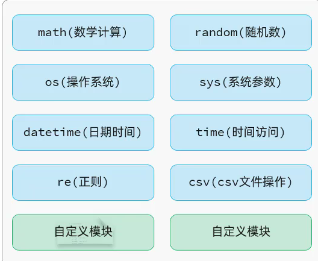
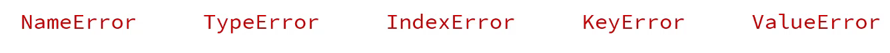

# 基础

## 1.字面量

| 大类                | 细分                      | 说明                    | 示例                     |
| ------------------- | ------------------------- | ----------------------- | ------------------------ |
| **数字类型**        | 整数 (int)                | 整型数字                | `10、18、-5、0`          |
|                     | 浮点数 (float)            | 小数 / 浮点数值         | `8.5、3.14、1.0、-3.5`   |
| **布尔 (bool)**     | -                         | 逻辑真假                | `True、False`            |
| **字符串 (str)**    | -                         | 文本数据，引号包裹      | `"人生苦短，我用Python"` |
| **空值 (NoneType)** | -                         | 空、无数据，唯一值 None | `None`                   |
| **数据容器**        | 列表 / 元组 / 集合 / 字典 | 存放多条数据            | 后续详解                 |

## 2.数据类型

### 2.1基础数据类型

| 标准名称 | 描述   | 说明                                      |
| -------- | ------ | ----------------------------------------- |
| int      | 整数   | 数字类型，存放整数，如：10  -5            |
| float    | 浮点数 | 数字类型，存放小数，如：8.5 3.14 1.0 -3.5 |
| str      | 字符串 | 用引号引起来的都是字符串，如："Python"    |
| bool     | 布尔   | 布尔类型，描述真和假，如：True False      |
| NoneType | 空值   | 表示空或无值，仅包含一个值 None           |

**通过 type(变量) 查看变量里面存储数据的类型** 

**通过isinstance(变量名, 类型) 用来判断是否为指定的数据类型**

## 3.字符串拼接

- 字符串类型可以直接使用 + 号拼接       **str(age) 强制转换变量中数据的类型**
- 使用 % 占位符：`print("我是 % 今年 % 岁，以后多多关照" % (name, age)`
- 使用 `f""我是 {name} 今年 {age} 岁，以后多多关照""`

## 4.输入和输出

- 输入：`input("请输入您的姓名：")`   	`age = int(input("请输入您的年龄："))`
- 输出：`print()`

## 5.运算符

| 运算符 | 描述        | 举例说明                               |
| ------ | ----------- | -------------------------------------- |
| `+`    | 加法        | `1 + 5`：1 加上 5                      |
| `-`    | 减法        | `8 - 3`：8 减 3                        |
| `*`    | 乘法        | `3 * 8`：3 乘以 8                      |
| `/`    | 除法        | `10 / 5`：10 除以 5，结果为浮点小数    |
| `//`   | 整除        | `10 // 3`：10 整除 3，结果向下取整整数 |
| `%`    | 取余 / 求模 | `10 % 3`：10 除以 3 取余数，结果 = 1   |
| `**`   | 幂指数      | `10 ** 3`：10 的 3 次方                |

## 6.逻辑运算符

- and	并且
- or           或
- not         取反


## 7.流程控制

### 7.1if

```python
# if...elif...else多分支判断结构
if 要判断的条件1:
    # 条件1成立时执行代码
    条件成立时，执行对应的操作1
elif 要判断的条件2:
    # 条件1不成立、条件2成立时执行代码
    条件成立时，执行对应的操作2
else:
    # 前面所有条件都不成立时执行代码
    条件不成立时，执行的操作3
```

从上往下依次判断，**只要某一个条件满足，执行对应代码后直接跳出整个分支**

### 7.2match case

```python
match day:
    case "1":
        print("周一：工作会议日")
    case "2":
        print("周二：学习培训日")
    case "3":
        print("周三：项目开发日")
    case "4":
        print("周四：代码审查日")
    case "5":
        print("周五：总结规划日")
    case "6" | "7":
        print("周末：休息放松")
    case _:
        print("输入有误!!!")
```

### 7.3while

```python
# while循环语法格式
while 条件表达式:
    条件成立时，执行的操作（循环体语句）
    条件成立时，执行的操作（循环体语句）
    ......
else:
    # 可选：循环正常结束（非break跳出）才执行
    循环正常结束时，执行的操作
```

如果是`break`强制跳出循环，`else`不会执行。

### 7.4for

```python
# for循环结构
for 元素 in 待处理数据集:
    循环体代码(对元素进行处理)
else:
    # 可选：仅循环正常遍历完毕、未被break打断时执行
    循环结束时，执行的代码
```

`for`的`else`**只有循环正常走完才触发**，如果循环里用`break`提前跳出循环，`else`代码不会运行。

### 7.5拓展：range ()

**作用**: 生成指定规则的数字序列

**用法 1: `range(end)`** -> 获取一个从 0 开始，到 end 结束的数字序列（不含 end 本身）

- `range(5)`获取的数据就是 `0,1,2,3,4`

**用法 2: `range(start,end)`** -> 获取一个从 start 开始，到 end 结束的数字序列（不含 end 本身）

- `range(2,8)`获取的数据就是 `2,3,4,5,6,7`

**用法 3: `range(start,end,step)`** -> 获取一个从 start 开始，到 end 结束的数字序列，step 步长（不含 end 本身）

- `range(0,10,2)`获取的数据就是 `0,2,4,6,8`

**补充：**

- range 是**惰性序列**，不会一次性生成全部数字，节省内存；转列表用`list(range(...))`查看全部元素
- 支持负数步长实现倒序：`range(5,0,-1)` → `5,4,3,2,1`

# 数据容器

## 1.列表

### 1.1定义及特点

- 定义：`列表名称 = [元素1, 元素2.......]`
- 特点：有序，可以重复，元素可以修改

### 1.2遍历

- 正向索引：从0开始
- 反向索引：从-1开始

```python
for item in array:
	print(item)
```

### 1.3常见操作（增删改查）

| 方法      | 作用                                                         | 样例               |
| --------- | ------------------------------------------------------------ | ------------------ |
| append()  | 在列表的**尾部追加元素**                                     | s.append(10086)    |
| insert()  | 在指定**索引之前，插入该元素**                               | s.insert(0, 92)    |
| remove()  | **移除列表中第一个匹配到的值**                               | s.remove(75)       |
| pop()     | **删除**列表中指定索引位置的元素（如果未指定索引，**默认删最后一个**） | s.pop(2) / s.pop() |
| sort()    | 对列表进行排序 (列表元素的数据类型一致，才可以进行**排序**)  | s.sort()           |
| reverse() | **反转**列表元素                                             | s.reverse()        |

### 1.4切片（截取一部分）

- 语法：`array[开始索引:结束索引:步长]`
  - 开始索引默认为0，结束索引没有指定默认为列表的长度，步长未指定默认为1。
  - 不包含结束索引的元素

#### 1.5拓展：min() max() sum()  len()

- 得到列表中最大元素：`max(array)`
- 得到列表中最小元素：`min(array)`

- 对列表所有元素求和：`sum(array)`
- 得到列表的数据个数：`len(array)`

### 1.6解包

**合并列表并去重**

**方法一：**

```python
#案例2：合并两个列表中的元素，并对合并的结果进行去重处理(去除列表中的重复元素)
num_list1 = [19, 23, 54, 64, 875, 20, 109, 232, 123, 54]
num_list2 = [55, 80, 72, 35, 60, 123, 54, 29, 91]

# 1. 都添加到 list 1
for num in num_list2:
    num_list1.append(num)
    
# 2. 去重重复记录
result_list = [] # 去重重复记录后的列表
for num in num_list1:
    # 判断new_list中是否存在num元素，如果不存在，再添加
    if num not in result_list: # 判断元素是否存在于列表中，如果存在，则返回True；不存在，返回False
        result_list.append(num)

print("去重后的列表：", result_list)
```

**简化合并步骤**（解包）

```python
num_list1 = [1,2,3]
num_list2 = [4,5]
# 解包：将列表这一类容器解开成一个一个独立的元素
num_list = [*num_list1, *num_list2]
print(num_list) # [1,2,3,4,5]
```

**更简化方式**

使用 + 号

### 1.7列表推导式

**生成1-20的平方列表**

```python
num_list = [i**2 for i in range(1,21)]
```

- 含义：遍历`1~20`，把每个数字求平方，存入新列表
- `i**2`：表达式，对循环变量做运算；`for i in range(1,21)`：循环数据源
- 结果：`[1,4,9,16,...,400]`（1 到 20 各自的平方）

**生成1-20中偶数平方列表**

```
num_list = [i**2 for i in range(1,21) if i % = 0]
```

## 2.字符串

### 2.1特点

- 不可变
- 有序
- 可迭代
- 有索引

### 2.2切片

### 2.3常用方法

| 方法         | 作用                                                         | 样例                     |
| ------------ | ------------------------------------------------------------ | ------------------------ |
| find()       | 在字符串中查找子串，返回第一次出现的索引位置，找不到返回 - 1 | s.find('Python')         |
| count()      | 统计子串在字符串中出现的次数                                 | s.count('H')             |
| upper()      | 将字符串中的所有字母转换为大写                               | s.upper()                |
| lower()      | 将字符串中的所有字母转换为小写                               | s.lower()                |
| split()      | 将字符串按指定分隔符分割成**列表**                           | s.split(' ')             |
| strip()      | **去除字符串两端的空白字符**或指定字符                       | s.strip() / s.strip('*') |
| replace()    | 将字符串中的指定**子串替换为新的子串**                       | s.replace('H','C')       |
| startswith() | 检查字符串是否以指定子串开头，返回布尔值                     | s.startswith('P')        |

**所有返回的字符串都是新创建的字符串，不会改变原有字符串**

## 3.元组

### 3.1定义及特点

**定义：**

- `元组名 = (元素1, 元素2, ......)`
- 空元组：`元组名称 = tuple()`       `元组名称 = ()`
- **注意：**定义元素的元组：`元组名 = 100`

**特点：**

- **不可修改**
- 可重复
- 有序

### 3.2常见方法

- count()：统计某个元素出现的次数
- index()：查找某个元素在元组中第一次出现的位置

### 3.3组包和解包

```python
# 定义元组，组包
t1 = (5, 7, 9, 1)
# 定义元组，组包
t2 = 5, 7, 9, 1

# 基础解包
a, b, c, d = t1

# (*)扩展解包
x, *y, z = t2  # x为5, y为[7, 9], z为1
s, *o = t2     # s为5, o为[7, 9, 1]
*o, e = t2     # o为[5, 7, 9], e为1

# 交换元素
a = 10
b = 20
# 组包再解包分别给到 a,b
a,b = b,a
```

## 4.集合

### 4.1定义及特点

**定义：**

- `s = {1, 2, ....}`
- 空集合：`s = set()`

**特定：**

- 无序
- 不重复
- 可修改

### 4.2常见方法

| 操作           | 含义                                                         | 样例                |
| -------------- | ------------------------------------------------------------ | ------------------- |
| add(..)        | 添加元素到集合中                                             | s1.add('t')         |
| remove(..)     | 移除集合中的指定元素（指定元素不存在将报错）                 | s1.remove('t')      |
| pop()          | 随机删除集合中的元素并返回                                   | e = s1.pop()        |
| clear()        | 清空集合                                                     | s1.clear()          |
| difference()   | 求取两个集合的差集（包含在第一个集合但不包含在第二个集合的元素） | s1.difference(s2)   |
| union()        | 求取两个集合的并集                                           | s1.union(s2)        |
| intersection() | 求取两个集合的交集                                           | s1.intersection(s2) |

## 5.字典

### 5.1特点

- key不能重复
- value可以修改
- **字典中的value值可以是任意类型的数据，但是key不能是可变类型（list set dict）**

### 5.2常用方法

| 类型 | 操作                   | 含义                                                | 样例                       |
| ---- | ---------------------- | --------------------------------------------------- | -------------------------- |
| 添加 | 字典名称 [key] = value | 往指定字典中添加 key-value 键值对                   | dict1 ["涛哥"] = 688       |
| 删除 | 字典名称.pop (key)     | 删除字典中指定的 key，并**返回该 key 对应的 value** | score = dict1.pop ("涛哥") |
| 删除 | del 字典名称 [key]     | 删除字典中指定的键值对                              | del dict1 ["涛哥"]         |
| 修改 | 字典名称 [key] = value | 修改字典中指定的 key 对应的值                       | dict1 ["小智"] = 658       |
| 查询 | 字典名称 [key]         | 根据 key 获取 value                                 | dict1 ["涛哥"]             |
| 查询 | 字典名称.get (key)     | 根据 key 获取 value                                 | dict1.get ("涛哥")         |
| 查询 | 字典名称.keys ()       | 获取所有的 key                                      | dict1.keys()               |
| 查询 | 字典名称.values ()     | 获取所有的 value                                    | dict1.values()             |
| 查询 | 字典名称.items ()      | 获取所有的 key-value 键值对                         | dict1.items()              |

# 函数

## 1.定义

```python
# 定义函数
def 函数名(参数列表):
    函数体
    ......
    return 返回值

# 调用函数
函数名(参数)
```

## 2.参数和返回值

- 多个返回值使用**逗号分隔**，返回的结果是一个**元组**

## 3.拓展：round()

- round(result, 保留小数的位数)

## 4.变量作用域

- 在函数内部可以使用 **global** 关键字把变量的作用域改为全局变量：`global num`

## 5.传参方式

- 位置传参

  ```python
  def func(a, b):
      return a + b
  func(10, 20)
  ```

- 关键字传参

  ```python
  # 顺序不影响
  func(b = 20, a = 10)
  ```

- 结合传参

  ```python
  # 需要先写位置参数
  func(10, b = 20)
  ```

## 6.默认参数

```python
# 默认参数必须定义在非默认参数之后
def func(a, b = 5):
    return a + b
func(3)
```

## 7.可变参数

```python
# *args 接收多个位置参数 → 元组
def func(*args):pass
func(1,2,3)

# **kwargs接收多个关键字参数 → 字典
def func(**kwargs):pass
func(x=1,y=2)
```

```python
def func(*args, **kwargs):
    print(a,b,args,kwargs)

func(1,2,3,4,x=100,y=200)
# args=(1, 2, 3, 4), kwargs={'x':100, 'y':200}
```

## 8.匿名函数

```python
# 不能写 return 关键字
lambda : print('------------------------')

lambda x, y: x + y

# 例子 按照每个元素的长度排序（倒序）
num_list = ["z", "baga", "a", "jsgodsfl", "sjldgjsdlof"]
num_list.sort(key = lambda item : len(item), reverse = True)
```

# 模块

## 1.常见模块



## 2.导入方式

| 导入形式                          | 代码样例                           | 调用方式       | 示例调用                |
| --------------------------------- | ---------------------------------- | -------------- | ----------------------- |
| import 模块名                     | import random, os                  | 模块名。功能名 | random.randint(10, 100) |
| import 模块名 as 别名             | import random as rd                | 别名。功能名   | rd.randint(10, 100)     |
| from 模块名 import 功能名         | from random import randint,choice  | 功能名         | randint(10, 100)        |
| from 模块名 import 功能名 as 别名 | from random import randint as rint | 别名           | rint(10, 100)           |
| from 模块名 import *              | from random import *               | 功能名         | randint(10, 100)        |

## 3.包的方式

| 导入形式                        | 代码样例                                | 调用方式             | 调用示例                      |
| ------------------------------- | --------------------------------------- | -------------------- | ----------------------------- |
| import 包名。模块名             | import utils.my_fun                     | 包名。模块名。功能名 | utils.my_fun.log_separator1() |
| from 包名 import 模块名         | from utils import my_fun                | 模块名。功能名       | my_fun.log_separator1()       |
| from 包名 import *              | from utils import *                     | 模块名。功能名       | my_fun.log_separator1()       |
| from 包名。模块名 import 功能名 | from utils.my_fun import log_separator1 | 功能名               | log_separator1()              |
| from 包名。模块名 import *      | from utils.my_fun import *              | 功能名               | log_separator1()              |

# 面向对象

## 1.基本使用

```python
class Car:
    def __init__(self, name, color):
        self.name = name
        self.color = color
        print("创建了一个车")
    pass

c = Car("BMW", "white")

print(c) # 打印的是地址
print(c.__dict__) # 以字典的形式输出
```

## 2.实例方法

```python
# 定义类
class 类名:
    def __init__(self, 形参列表):
        self.属性名 = 参数值
        self.属性名 = 参数值

    def 方法名(self, 形参列表):
        ...
    def 方法名(self, 形参列表):
        ...

# 创建对象
对象名 = 类名(参数列表)
对象名.方法名(实参)
```

## 3.魔法方法

| 魔法方法                       | 描述                                                         |
| ------------------------------ | ------------------------------------------------------------ |
| **init**                       | 初始化方法                                                   |
| **str**                        | 字符串表示的方法                                             |
| **eq**                         | 比较两个对象是否相等（equal）                                |
| **lt**, **le**, **gt**, **ge** | 支持比较两个对象的大小 (小于 (less than)，小于等于 (less than or equal)，大于 (greater than)，大于等于 (greater than or equal)) |

## 4.实例属性和类属性

```python
class Car:
    # 类属性 类名.wheel 调用
    wheel = 4       # 轮胎数量
    tax_rate = 0.1  # 购置税

    def __init__(self, c_brand, c_name, c_price):
        # 实例属性  示例.name调用
        self.brand = c_brand
        self.name = c_name
        self.price = c_price

    def running(self):
        print(f"{self.brand} {self.name} 正在高速行驶...")

# 创建实例对象
c1 = Car("BYD", "汉", 180000)
c2 = Car("Tesla", "Model Y", 260000)
```

# 异常

## 1.基本使用



```python
try:
    可能出现异常的业务代码1
    可能出现异常的业务代码2
    ...
except [异常类型 as 变量名]:
    出现异常时的预案
[finally:
    不管是否出现异常，都会执行的代码 ]
```

# 文件操作

## 1.读写文件

```python
f = open("resources/a.txt", "r", encoding="utf-8")

# 读取所有内容
# content = f.read()
# print(content)

# 读取所有行
content_list = f.readlines()
for line in content_list:
    print(line.strip())

f.close()
```

```python
f = open("resources/静夜思.txt", "w", encoding="utf-8")

# 会把原数据覆盖
f.write("窗前明月光\n")
f.write("疑是地上霜\n")

f.close()
```

## 2.使用with保证资源释放

```python
f = open("resources/静夜思.txt", "w", encoding="utf-8")

try:
    f.write("窗前明月光\n")
    f.write("疑似地上霜\n")
    f.write("举头望明月\n")
    f.write("低头思故乡\n")
except Exception as e:
    print(e)
finally:
    f.close()
```

```python
with open("resources/静夜思.txt", "w", encoding="utf-8") as f:
    f.write("窗前明月光\n")
    f.write("疑似地上霜\n")
    f.write("举头望明月\n")
    f.write("低头思故乡\n")
```

## 3.Json 序列化

```python
# 写入json数据（序列化）
import json

obj = {
    "name": "张三",
    "age": 18,
    "gender": "男",
    "hobbies": ["reading", "swimming"]
}
with open("resources/session.json", "w", encoding="utf-8") as f:
    json.dump(obj, f, ensure_ascii=False, indent=2)

# 读取json数据（反序列化）
import json

with open("resources/session.json", "r", encoding="utf-8") as f:
    obj = json.load(f)
print(obj)
```

